# Phiên bản nâng cấp phục vụ tiểu luận

Ngày thực hiện: 13/11/2026. Tài liệu này mô tả bản triển khai sau [rà soát ban đầu](RA_SOAT_VA_LO_TRINH_NANG_CAP.md).

## Chức năng đã bổ sung

| Nhóm | Hành vi của bản nâng cấp |
|---|---|
| Sản phẩm | Nhiều SKU với tên phân loại, giá và kho riêng; seller thêm/sửa/ngừng bán; SKU cũ vẫn giữ cho lịch sử đơn |
| Mua hàng | Chọn riêng dòng giỏ cần mua; mua ngay chỉ mua phân loại đang chọn; server tính lại toàn bộ giá/voucher/phí; chống tạo đơn trùng bằng idempotency key |
| Giao hàng | 30.000đ/shop; miễn phí nếu tiền hàng shop trước giảm giá từ 500.000đ; carrier/mã vận đơn do seller nhập; lịch sử trạng thái có thời điểm và người thao tác |
| Tồn kho/voucher | Transaction Serializable có retry, giảm kho có điều kiện, chống hoàn kho hai lần và vượt lượt voucher khi nhiều request đồng thời |
| COD | Ghi nhận tiền thu khi seller xác nhận đã giao; trạng thái thanh toán tổng hợp theo các đơn shop; đơn cũ có nút đối chiếu khoản thu thay vì tự ghi nhận tiền chưa kiểm tra |
| MoMo | Chuẩn hóa IPN kiểu số/chuỗi, kiểm tra chữ ký/đối tác/số tiền/request, theo dõi lần thử, IPN 204, callback lặp không ghi nhận hai lần, thanh toán lại và hết hạn sau 30 phút |
| Hủy/trả hàng | Hủy đúng trạng thái; khách yêu cầu trả toàn bộ đơn shop trong 7 ngày; seller chấp thuận/từ chối, xác nhận nhận hàng; admin có thể xét lại yêu cầu bị từ chối |
| Hoàn tiền | Tạo khoản hoàn chờ xử lý khi đơn đã thu tiền bị hủy/nhận trả; admin ghi mã đối chiếu sau khi chuyển tiền; cập nhật hoàn toàn phần/một phần |
| Thống kê | Khoảng ngày từ–đến, giờ Việt Nam; phân biệt tiền thu, tiền hoàn và giá trị hàng giao; biểu đồ thể hiện cả ngày âm; xuất CSV UTF-8 |
| Tài khoản | Sửa hồ sơ, đổi mật khẩu và thu hồi token cũ; sổ địa chỉ thêm/sửa/xóa/đặt mặc định |
| Ảnh | Upload JPEG/PNG/WebP tối đa 2MB/file; lưu PostgreSQL để không mất khi Render khởi động lại; giới hạn 200 ảnh/tài khoản |
| Phân quyền | Chặn STAFF quản lý staff/khóa user, bảo vệ ADMIN, kiểm tra trạng thái tài khoản trên API/socket |
| Giao diện | Phân trang danh sách đơn/sản phẩm seller, lọc giá/sắp xếp, dọn cache khi đổi tài khoản, tải từng trang bằng lazy loading |
| Chat | Tải lịch sử theo trang, đánh dấu đã đọc khi xem, đếm tin chưa đọc, sửa link thông báo cho seller, nối lại room sau reconnect |
| Kiểm thử | Bộ integration chạy PostgreSQL riêng, kiểm thử trình duyệt bằng Playwright, workflow GitHub Actions |

Các chức năng kế thừa như đăng ký, shop, danh mục, review, quảng cáo và thông báo vẫn nằm trong source. Không xem việc build thành công là bằng chứng đã kiểm thử hết mọi màn hình cũ.

## Quy tắc nghiệp vụ cần mô tả trong báo cáo

1. Một lần checkout tạo một Order và nhiều ShopOrder. Mỗi shop nhận phần giảm giá phân bổ riêng; tổng các phần đúng bằng giảm giá của Order, kể cả làm tròn.
2. Giá và tên sản phẩm/SKU được chụp tại thời điểm mua. Sửa sản phẩm sau đó không thay đổi giá đơn cũ.
3. Product.stock và Product.price là dữ liệu tổng hợp để hiển thị: tổng kho và giá thấp nhất của SKU đang bán. Giao dịch trừ kho trên SKU.
4. Chỉ chuyển đơn MoMo sang xử lý khi khoản cần thu của shop đã được thanh toán. Đơn chưa trả hết hạn được hủy và hoàn kho bởi tác vụ định kỳ hoặc khi đọc/checkout đơn.
5. Đơn COD nhiều shop có thể thu từng phần. Khi shop xác nhận DELIVERED, hệ thống ghi số tiền shop đã thu; đây là giả định nghiệp vụ demo, chưa đối soát hãng vận chuyển.
6. Hủy toàn bộ đơn giải phóng lượt voucher. Hủy một phần giữ nguyên lượt dùng; tiền đơn gốc giữ nguyên để đối chiếu, khoản hoàn được lưu riêng.
7. Trả hàng hiện áp dụng toàn bộ ShopOrder. Khi được chấp thuận, hàng chưa tự hoàn kho; chỉ hoàn kho sau RECEIVED. Khoản hoàn gồm toàn bộ tiền shop đã thu, kể cả phí giao hàng theo chính sách demo.
8. Hoàn tiền là thao tác thủ công có mã đối chiếu. Nút xác nhận chỉ ghi nhận việc đã hoàn; không thực hiện chuyển tiền qua MoMo/ngân hàng.
9. Thực thu ròng trong kỳ = tiền thu trong kỳ − khoản hoàn hoàn tất trong kỳ. MoMo ghi theo paidAt; COD theo thời điểm giao/thu của shop. Giá trị hàng giao và top sản phẩm/danh mục theo deliveredAt, trước giảm giá, không gồm phí giao.
10. Số người dùng/shop và khoản hoàn đang chờ là số liệu hiện tại; chỉ số giao dịch và lượt voucher theo kỳ được chọn. Top shop thể hiện tiền đã thu trước hoàn tiền.

## Dữ liệu demo

- Script tạo 10 sản phẩm cho mỗi danh mục hiện có; đồng thời bảo đảm có 10 danh mục mẫu. Với dữ liệu gốc trên máy, đã thêm 100 sản phẩm và giữ 5 sản phẩm cũ.
- Mỗi sản phẩm demo có 3 SKU. Sản phẩm thứ 9 chỉ có 1 đơn vị ở SKU đầu; sản phẩm thứ 10 hết kho. Dùng các trường hợp này để thử giới hạn mua và đặt đồng thời.
- Có 5 shop demo, email seller1@ecom.local đến seller5@ecom.local; mật khẩu password123. Các tài khoản admin@ecom.local, seller@ecom.local và customer@ecom.local từ seed gốc dùng password123 nếu chưa được đổi.
- Voucher sàn: TIEULUAN10, giảm 10%, tối đa 100.000đ, đơn tối thiểu 100.000đ.
- Ảnh là ảnh minh họa theo danh mục; tên, giá và mô tả chỉ phục vụ kiểm thử, không phải thông tin kinh doanh thực.
- Chạy lại seed không tạo trùng hoặc ghi đè tài khoản/sản phẩm đã tồn tại. Seed không tạo đơn giả hay doanh thu giả.

```powershell
cd backend
npx prisma migrate deploy
npm run db:seed:demo
```

## Các phần còn có thể phát triển

Chưa tích hợp hãng vận chuyển, tự động hoàn tiền, trả từng OrderItem, email quên mật khẩu, phí/đối soát seller, nhật ký quản trị toàn hệ thống, wishlist, flash sale hoặc gợi ý cá nhân hóa. Xuất báo cáo hiện là CSV; XLSX/PDF và OpenAPI có thể bổ sung ở đợt sau. Tác vụ hết hạn chạy trong tiến trình API mỗi phút, chưa dùng worker hàng đợi riêng.

## Khung trình bày đóng góp mới

Đề tài tham khảo: **Phát triển hệ thống sàn thương mại điện tử đa người bán hỗ trợ quản lý biến thể sản phẩm và quy trình đổi trả**.

- Bài toán 1: cùng một sản phẩm nhưng nhiều SKU → thiết kế kho theo phân loại, chụp thông tin SKU vào đơn.
- Bài toán 2: nhiều người mua cùng lúc → transaction, cập nhật có điều kiện, retry và kiểm thử tranh hàng/lượt voucher.
- Bài toán 3: một lần mua nhiều shop → phân bổ giảm giá, phí theo shop, thanh toán/hoàn tiền từng phần.
- Bài toán 4: vận hành sau bán → lịch sử, yêu cầu trả hàng, xét duyệt và đối chiếu khoản hoàn.
- Bài toán 5: tính đúng số liệu → thống kê theo thời điểm nghiệp vụ và múi giờ, tách GMV/tiền thu/tiền hoàn.

### Sơ đồ vòng đời đơn

```mermaid
stateDiagram-v2
  [*] --> PENDING
  PENDING --> CONFIRMED: người bán xác nhận; MoMo phải đã trả
  PENDING --> CANCELLED: khách/seller hủy hoặc hết hạn MoMo
  CONFIRMED --> CANCELLED: khách/seller hủy
  CONFIRMED --> SHIPPING: đã nhập vận đơn
  SHIPPING --> DELIVERED: xác nhận giao; ghi thu COD
  DELIVERED --> RETURNED: yêu cầu được duyệt và đã nhận hàng trả
  CANCELLED --> [*]
  RETURNED --> [*]
```



Yêu cầu trả hàng có trạng thái riêng REQUESTED → APPROVED/REJECTED → RECEIVED. Khoản hoàn có PENDING → COMPLETED và được kiểm soát bởi ADMIN.

Kết quả kiểm thử và hướng dẫn triển khai xem [KIEM_THU_VA_TRIEN_KHAI.md](KIEM_THU_VA_TRIEN_KHAI.md).
