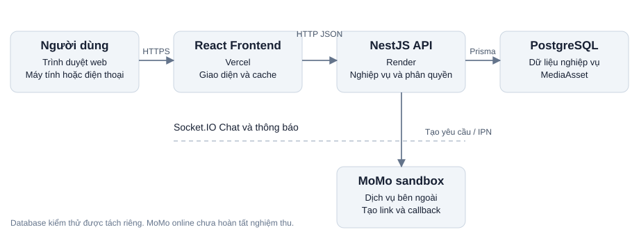
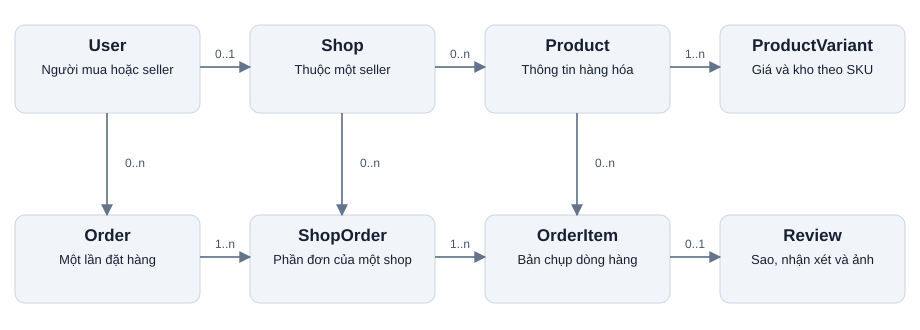
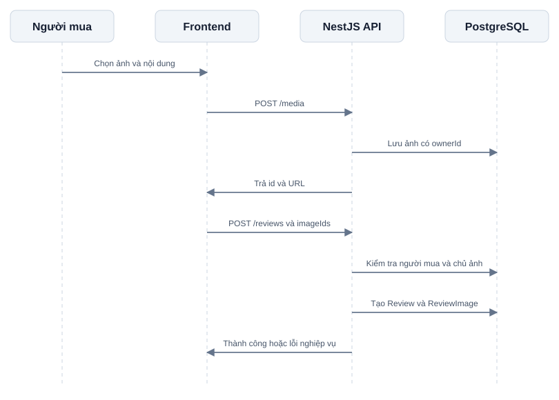
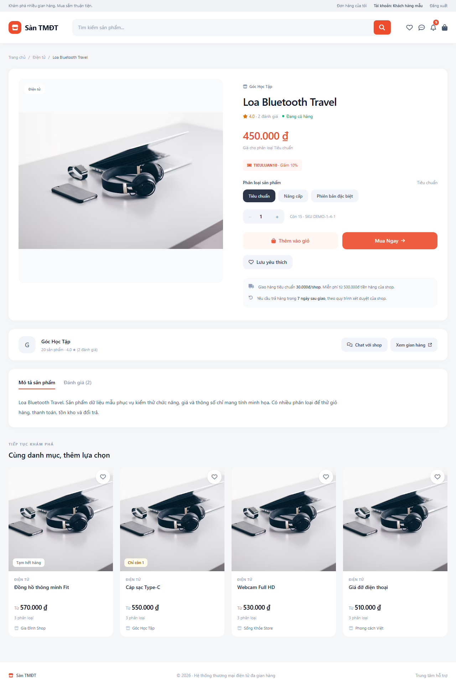
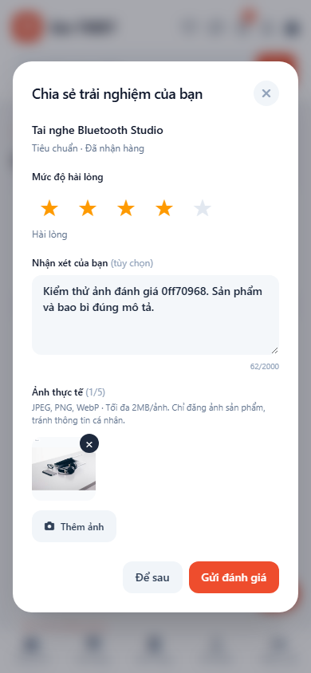
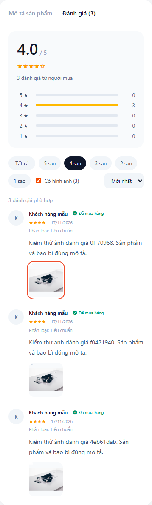
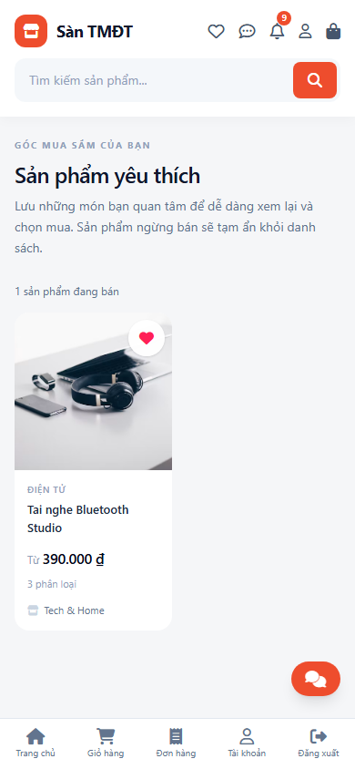
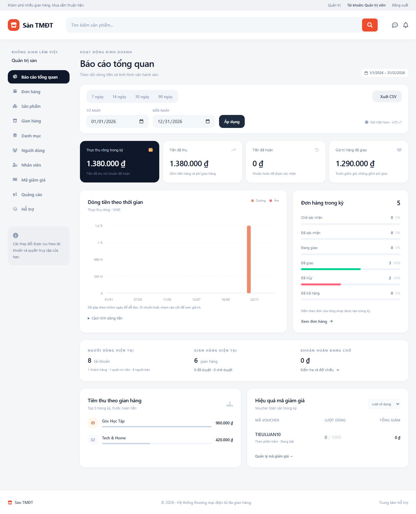

# Báo cáo tiểu luận

## Phát triển hệ thống sàn thương mại điện tử đa người bán

**Quản lý biến thể sản phẩm, quy trình sau bán và đánh giá có hình ảnh**

Trường: [Bổ sung tên trường]

Khoa hoặc bộ môn: [Bổ sung khoa hoặc bộ môn]

Học phần: [Bổ sung tên học phần]

Giảng viên hướng dẫn: [Bổ sung họ tên giảng viên]

Sinh viên thực hiện: **Lê Gia Bảo**

Mã số sinh viên: **DC24V7K505**

Ngày hoàn thiện phiên bản hệ thống: **17 tháng 11 năm 2026**

<!-- pagebreak -->

## Tóm tắt

Đề tài phát triển một hệ thống sàn thương mại điện tử đa người bán trên nền tảng web. Hệ thống hỗ trợ khách hàng tìm kiếm, lựa chọn phân loại, mua hàng từ nhiều gian hàng, theo dõi giao hàng, yêu cầu trả hàng và đánh giá trải nghiệm sau khi nhận sản phẩm. Người bán quản lý sản phẩm, tồn kho, đơn hàng, mã giảm giá và quảng cáo. Quản trị viên và nhân viên vận hành thực hiện các tác vụ theo phạm vi quyền được cấp.

Phiên bản tiểu luận kế thừa mã nguồn niên luận và mở rộng theo ba nhóm vấn đề. Nhóm thứ nhất là tính đúng của giao dịch: quản lý tồn kho theo SKU, chống đặt hàng trùng, phân bổ giảm giá theo shop và đối chiếu thanh toán. Nhóm thứ hai là vận hành sau bán: lịch sử đơn, giao hàng, trả hàng, ghi nhận hoàn tiền thủ công và báo cáo theo khoảng thời gian. Nhóm thứ ba là trải nghiệm người mua: đánh giá có ảnh, xác nhận người đã mua, lọc đánh giá, lưu sản phẩm yêu thích và bảo toàn bộ lọc khi quay lại danh mục.

Ứng dụng sử dụng React và TypeScript ở frontend, NestJS ở backend, PostgreSQL cùng Prisma để quản lý dữ liệu. Kết quả kiểm thử trên môi trường local gồm 14 unit test, 30 integration test và 11 ca kiểm thử trình duyệt. Các ca mới kiểm chứng quyền sở hữu ảnh, điều kiện đánh giá sau giao hàng, chống đánh giá trùng, tính riêng tư của danh sách yêu thích và hành vi giao diện trên màn hình rộng 390 pixel.

Hệ thống có thể trình diễn quy trình mua và vận hành bằng COD. Tích hợp MoMo sandbox tạo được liên kết trên máy local, nhưng tại thời điểm kiểm tra, kết nối tạo thanh toán từ Render và Vercel bị trả HTTP 403. Báo cáo ghi nhận rõ giới hạn này, không xem các kiểm thử mô phỏng là bằng chứng thanh toán ví đã hoạt động trực tuyến.

**Từ khóa:** thương mại điện tử đa người bán, SKU, giao dịch đồng thời, đánh giá có ảnh, danh sách yêu thích, kiểm thử tích hợp.

## Mục lục

| Nội dung | Trang |
|---|---|
| Tóm tắt | 2 |
| Chương 1 Tổng quan đề tài | 4 |
| Chương 2 Cơ sở công nghệ và phương pháp thực hiện | 6 |
| Chương 3 Phân tích yêu cầu và thiết kế hệ thống | 8 |
| Chương 4 Xây dựng và nâng cấp chức năng | 14 |
| Chương 5 Kiểm thử và đánh giá kết quả | 21 |
| Chương 6 Kết luận và hướng phát triển | 24 |
| Tài liệu tham khảo | 25 |
| Phụ lục A Triển khai và kiểm thử lại | 26 |
| Phụ lục B Kịch bản trình diễn | 27 |

### Danh mục hình

| Hình | Trang |
|---|---|
| Hình 3.1 Kiến trúc tổng thể của hệ thống | 9 |
| Hình 3.2 Các quan hệ thương mại cốt lõi | 10 |
| Hình 3.3 Trình tự gửi đánh giá có ảnh | 12 |
| Hình 4.1 Giao diện chi tiết và lựa chọn phân loại | 15 |
| Hình 4.2 Biểu mẫu đánh giá có ảnh trên điện thoại | 16 |
| Hình 4.3 Tổng hợp và lọc đánh giá trên điện thoại | 17 |
| Hình 4.4 Danh sách yêu thích trên điện thoại | 18 |
| Hình 4.5 Giao diện báo cáo quản trị | 20 |

Danh mục hình gồm kiến trúc triển khai, quan hệ dữ liệu thương mại, trình tự đánh giá có ảnh và các màn hình minh họa. Các số liệu và hình giao diện trong báo cáo phục vụ kiểm thử trên dữ liệu mẫu; không biểu thị giao dịch hoặc hoạt động kinh doanh thực tế.

## Chương 1 Tổng quan đề tài

### 1.1 Bài toán và lý do lựa chọn

Một sàn thương mại điện tử cần phối hợp nhiều quy trình có liên quan chặt chẽ. Khách hàng quan tâm đến giá, phân loại, tình trạng còn hàng và độ tin cậy của nhận xét. Người bán cần biết chính xác số lượng có thể bán và trạng thái đơn thuộc gian hàng của mình. Bộ phận quản trị cần số liệu có thể đối chiếu giữa tiền thu, tiền hoàn và hàng đã giao. Nếu chỉ hoàn thiện màn hình mà chưa ràng buộc nghiệp vụ ở máy chủ, các thao tác đồng thời hoặc gửi lại yêu cầu có thể làm sai dữ liệu.

Trong mô hình đa người bán, một lần đặt hàng có thể chứa sản phẩm của nhiều shop. Vì vậy, việc chia đơn, tính phí giao hàng và phân bổ mã giảm giá phải nhất quán. Sau khi giao hàng, hệ thống tiếp tục xử lý đánh giá, trả hàng và hoàn tiền. Đây là các vấn đề phù hợp để nghiên cứu dưới dạng một ứng dụng web có cơ sở dữ liệu quan hệ và kiểm thử tự động.

Mã nguồn niên luận đã có các chức năng nền tảng như đăng ký, sản phẩm, giỏ hàng, đặt hàng, chat, quảng cáo và thống kê. Bản tiểu luận tập trung mở rộng chiều sâu nghiệp vụ và khả năng kiểm chứng, đồng thời cải thiện các thao tác người dùng thường thực hiện. Việc kế thừa giúp so sánh rõ hạn chế trước nâng cấp và kết quả sau triển khai.

### 1.2 Mục tiêu

Mục tiêu tổng quát là xây dựng phiên bản có thể trình diễn nhất quán quy trình mua hàng và vận hành sau bán. Mỗi thay đổi cần có quy tắc rõ ràng ở backend, giao diện thể hiện đúng trạng thái và bằng chứng kiểm thử phù hợp.

Các mục tiêu cụ thể gồm quản lý sản phẩm theo SKU; bảo vệ tồn kho và lượt voucher khi có yêu cầu đồng thời; chia đơn theo shop; quản lý giao, hủy và trả hàng; phân biệt tiền thu với tiền hoàn trong báo cáo; hỗ trợ đánh giá kèm ảnh sau giao hàng; bổ sung danh sách yêu thích riêng của khách hàng; và cải thiện trải nghiệm trên máy tính lẫn điện thoại.

### 1.3 Đối tượng và phạm vi

Đối tượng sử dụng gồm khách vãng lai, khách hàng, người bán, nhân viên vận hành và quản trị viên. Người dùng đã đăng nhập có một trong bốn vai trò CUSTOMER, SELLER, STAFF hoặc ADMIN. Khách vãng lai được xem các nội dung công khai; quyền thay đổi dữ liệu phụ thuộc vai trò và quan hệ sở hữu.

Phạm vi triển khai là ứng dụng web và dữ liệu demo. Phí giao hàng sử dụng quy tắc cố định theo shop. Mã vận đơn do người bán nhập; hệ thống chưa kết nối hãng vận chuyển. Hoàn tiền được ghi nhận sau khi quản trị viên hoàn tiền bên ngoài và nhập mã đối chiếu. Hệ thống chưa thực hiện quyết toán tiền cho người bán, thu phí sàn hoặc hoàn tiền tự động qua cổng thanh toán.

### 1.4 Đóng góp so với phiên bản niên luận

| Nội dung | Hạn chế trước mở rộng | Kết quả của bản tiểu luận |
|---|---|---|
| Phân loại sản phẩm | Kho và giá chưa được quản lý đầy đủ theo phân loại | Mỗi SKU có giá, kho và trạng thái riêng; đơn giữ bản chụp thông tin |
| Đặt hàng | Dễ lặp thao tác và khó đối chiếu khi nhiều shop | Idempotency key, chia ShopOrder, tính lại giá và phân bổ giảm giá ở server |
| Sau bán | Theo dõi trạng thái còn đơn giản | Lịch sử, vận đơn, trả hàng theo đơn shop và ghi nhận khoản hoàn |
| Báo cáo | Khó phân biệt doanh số với dòng tiền | Tách tiền thu, tiền hoàn, thực thu ròng và giá trị hàng giao theo kỳ |
| Đánh giá | Chỉ sao và nhận xét; thao tác ở danh sách đơn | Tối đa 5 ảnh, thông tin phân loại, lọc theo sao/có ảnh, xem ảnh lớn và đánh giá ngay trong chi tiết đơn |
| Mua sắm | Chưa có nơi lưu món quan tâm | Danh sách yêu thích lưu theo tài khoản, có phân trang và thao tác trên thẻ sản phẩm |
| Điều hướng | Bộ lọc dễ mất khi rời trang | Bộ lọc nằm trên URL, phục hồi khi tải lại hoặc quay lại danh mục |
| Chất lượng | Chưa có bằng chứng kiểm thử đầy đủ cho phần mở rộng | Unit, integration, trình duyệt và workflow kiểm tra trên GitHub |

### 1.5 Phương pháp thực hiện

Quá trình thực hiện bắt đầu bằng việc đọc mã nguồn, schema, migration, API và các màn hình theo vai trò. Sau đó, từng vấn đề được chuyển thành quy tắc nghiệp vụ và kịch bản kiểm thử. Thay đổi dữ liệu sử dụng migration bổ sung; dữ liệu local được sao lưu trước khi áp dụng. Các chức năng mới được kiểm tra trên database riêng, tiếp theo là kiểm thử trình duyệt và kiểm tra giao diện bằng ảnh chụp.

Phương pháp này cho phép phân biệt ba loại bằng chứng: hành vi đã thực hiện trong source, hành vi đã kiểm chứng bằng chương trình và hành vi phụ thuộc dịch vụ bên ngoài. Sự phân biệt đặc biệt cần thiết đối với thanh toán, vì mô phỏng callback hợp lệ không đồng nghĩa với việc đã thanh toán qua ví thật.

## Chương 2 Cơ sở công nghệ và phương pháp thực hiện

### 2.1 Kiến trúc ứng dụng web

Hệ thống tổ chức theo kiến trúc frontend, API và cơ sở dữ liệu. Trình duyệt đảm nhiệm trình bày và thu thập thao tác. Backend xác thực, phân quyền, kiểm tra dữ liệu và thực hiện nghiệp vụ. PostgreSQL lưu dữ liệu có quan hệ và các ràng buộc cần bảo vệ. Frontend không được xem là nguồn tin cậy cho giá, tổng tiền, tồn kho hoặc trạng thái thanh toán.

Giao tiếp nghiệp vụ chủ yếu qua HTTP JSON dưới tiền tố `/api`. Chat và thông báo sử dụng Socket.IO để cập nhật khi có sự kiện. Ảnh được tải bằng multipart/form-data và được phục vụ qua endpoint media. Việc tách các luồng này giúp xử lý đúng loại dữ liệu và tránh đưa nội dung nhị phân lớn vào JSON của đánh giá.

### 2.2 React và quản lý trạng thái

React tổ chức giao diện thành các thành phần có thể tái sử dụng [1]. Trong hệ thống, thẻ sản phẩm, phân trang, hộp thoại, bảng báo cáo và biểu đồ là các thành phần dùng ở nhiều trang. TypeScript mô tả cấu trúc sản phẩm, đơn hàng và phản hồi API để phát hiện lỗi kiểu dữ liệu khi build.

TanStack Query quản lý dữ liệu lấy từ máy chủ, bộ nhớ đệm và việc tải lại sau thao tác [2]. Ví dụ, sau khi gửi đánh giá thành công, các truy vấn đơn hàng và đánh giá được đánh dấu cần cập nhật. Zustand lưu trạng thái xác thực. Khi chuyển sang tài khoản khác, bộ nhớ đệm riêng của tài khoản trước được xóa để tránh hiển thị nhầm dữ liệu.

Trạng thái tìm kiếm, danh mục, khoảng giá, cách sắp xếp và trang danh sách được đưa lên URL. Đây là trạng thái cần phục hồi khi quay lại hoặc chia sẻ liên kết. Ngược lại, nội dung đang soạn trong hộp thoại đánh giá là trạng thái cục bộ và không được đưa vào URL.

### 2.3 NestJS và kiểm soát truy cập

NestJS cung cấp cấu trúc module, controller, provider, pipe và guard để chia trách nhiệm xử lý [3]. Controller nhận yêu cầu; DTO xác định dữ liệu hợp lệ; service xử lý nghiệp vụ; Prisma truy cập cơ sở dữ liệu. Guard xác thực và kiểm tra vai trò trước khi cho phép thực hiện thao tác.

Hệ thống kiểm tra quyền ở hai mức. Mức vai trò xác định một khách hàng có được gọi API đánh giá hay không. Mức sở hữu xác định dòng hàng được đánh giá có thuộc đơn của khách đó hay không. Cách tiếp cận này cũng áp dụng cho đơn của shop, ảnh tải lên và danh sách yêu thích.

### 2.4 PostgreSQL và Prisma

PostgreSQL phù hợp với dữ liệu có quan hệ như User, Order, ShopOrder và OrderItem. Prisma mô tả schema, quan hệ, migration và cung cấp client có kiểu dữ liệu. Phiên bản dự án sử dụng Prisma 6.19.3; báo cáo mô tả hành vi của source hiện tại, không giả định dự án đã nâng lên API của các phiên bản ORM mới hơn.

Khóa ngoại duy trì liên kết giữa bản ghi. Ràng buộc duy nhất ngăn tạo nhiều đánh giá cho cùng một dòng đơn và nhiều mục yêu thích cho cùng một người dùng, sản phẩm. Các index phục vụ truy vấn theo shop, danh mục, tài khoản và thời điểm.

Transaction nhóm các thao tác liên quan để cùng thành công hoặc cùng hủy. Với các nghiệp vụ cạnh tranh kho và lượt voucher, hệ thống sử dụng mức cô lập Serializable và retry khi có xung đột. Serializable có thể phát sinh lỗi yêu cầu thực hiện lại giao dịch; ứng dụng cần xử lý tình huống này thay vì giả định mọi yêu cầu đều thành công ngay lần đầu [4].

### 2.5 Xác thực và dữ liệu ảnh

Access token được dùng cho các yêu cầu có xác thực. Refresh token được lưu dưới dạng băm ở database và gửi bằng cookie HttpOnly. Hệ thống xoay refresh token, kiểm tra trạng thái tài khoản và thu hồi khả năng sử dụng token cũ khi đổi mật khẩu. Mật khẩu không được lưu dạng văn bản thuần.

Đối với ảnh, backend kiểm tra kích thước, loại nội dung và các byte nhận diện cơ bản của JPEG, PNG, WebP. Đây là kiểm tra định dạng tệp, chưa phải cơ chế quét nội dung ảnh. Dữ liệu ảnh được lưu trong bảng MediaAsset để không phụ thuộc ổ đĩa tạm của máy chủ Render.

### 2.6 Chiến lược kiểm thử

Unit test phù hợp để kiểm tra các nhánh xử lý có phạm vi nhỏ, chẳng hạn chuẩn hóa lỗi cổng thanh toán. Integration test khởi tạo ứng dụng NestJS và gửi HTTP thật vào ứng dụng với PostgreSQL riêng. Các ca này kiểm tra đồng thời validation, guard, service và database.

Playwright kiểm tra thao tác trên trình duyệt: chọn SKU, nhập bộ lọc, tải ảnh, mở hộp thoại, lưu yêu thích và chuyển tài khoản. Kiểm thử trình duyệt cần chờ đúng phản hồi hoặc trạng thái giao diện; việc bấm nút xong ngay lập tức đọc màn hình cũ có thể tạo kết quả sai [5]. Các ảnh chụp sau kiểm thử được dùng để đánh giá bố cục và minh họa báo cáo.

## Chương 3 Phân tích yêu cầu và thiết kế hệ thống

### 3.1 Tác nhân và quyền sử dụng

| Tác nhân | Chức năng chính | Giới hạn quyền |
|---|---|---|
| Khách vãng lai | Xem danh mục, sản phẩm, shop và đánh giá công khai | Đăng nhập trước khi mua, lưu yêu thích hoặc gửi đánh giá |
| CUSTOMER | Giỏ hàng, địa chỉ, đặt hàng, theo dõi, hủy, trả hàng, đánh giá, yêu thích, chat | Chỉ thao tác dữ liệu và đơn của mình |
| SELLER | Quản lý shop, SKU, đơn shop, vận đơn, voucher và quảng cáo | Không quản lý sản phẩm hoặc đơn của shop khác |
| STAFF | Hỗ trợ vận hành theo các API được cấp quyền | Không có toàn bộ quyền ADMIN; bị chặn các thao tác quản trị nhạy cảm đã giới hạn |
| ADMIN | Quản trị người dùng, shop, nội dung, yêu cầu xóa quảng cáo, khoản hoàn và báo cáo | Các thao tác phải đi qua kiểm tra của API; tài khoản ADMIN được bảo vệ khỏi khóa nhầm |

### 3.2 Yêu cầu chức năng

| Mã | Yêu cầu | Tiêu chí chấp nhận chính |
|---|---|---|
| FR01 | Đăng ký và đăng nhập | Tài khoản hợp lệ nhận phiên; tài khoản bị khóa bị từ chối |
| FR02 | Tìm kiếm sản phẩm | Tìm không dấu và gần đúng; kết hợp danh mục, giá, sắp xếp, phân trang |
| FR03 | Quản lý SKU | Mỗi phân loại có mã, giá và kho; phân loại ngừng bán không được mua mới |
| FR04 | Giỏ hàng và mua ngay | Chọn đúng dòng/SKU; server xác định lại giá và số lượng |
| FR05 | Checkout nhiều shop | Tạo một Order và các ShopOrder; tổng phân bổ giảm giá phải khớp |
| FR06 | Giao và hủy đơn | Chỉ chuyển trạng thái hợp lệ; hoàn kho một lần khi cần |
| FR07 | Trả hàng và khoản hoàn | Yêu cầu trong thời hạn; chỉ hoàn kho khi nhận hàng trả; hoàn tiền có đối chiếu |
| FR08 | Đánh giá sau giao | Đúng người mua, đúng dòng hàng; mỗi dòng tối đa một đánh giá |
| FR09 | Ảnh đánh giá | Tối đa 5 ảnh đã tải lên bởi chính người đánh giá; xem được trên trang sản phẩm |
| FR10 | Đọc và lọc đánh giá | Lọc sao/có ảnh; sắp xếp thời gian; điểm tổng hợp không đổi theo bộ lọc |
| FR11 | Yêu thích | Lưu riêng theo tài khoản; thao tác lặp không thêm trùng; tối đa 500 sản phẩm |
| FR12 | Quảng cáo | Shop gửi yêu cầu xóa; ADMIN xử lý hoặc xóa trực tiếp; banner đã xóa không hiển thị công khai |
| FR13 | Báo cáo | Chọn kỳ, hiển thị tiền thu/hoàn/ròng; xuất CSV theo kỳ đã áp dụng |
| FR14 | Hồ sơ và địa chỉ | Sửa thông tin, đổi mật khẩu, quản lý địa chỉ mặc định |
| FR15 | Chat và thông báo | Giới hạn đúng người tham gia; phân trang, đánh dấu đã đọc |
| FR16 | Giữ ngữ cảnh mua sắm | Quay lại và tải lại danh mục vẫn giữ bộ lọc trên URL |

### 3.3 Yêu cầu phi chức năng

Hệ thống cần kiểm tra dữ liệu tại server, duy trì quan hệ dữ liệu và trả lỗi có thể hiểu được. Các biểu mẫu phải ngăn thao tác trùng khi đang gửi. Danh sách lớn cần phân trang. Giao diện cần sử dụng được ở kích thước 390 × 844 pixel, có nhãn thao tác và không tràn ngang trong các màn hình đã kiểm tra.

Về khả năng bảo trì, thay đổi schema được lưu thành migration, phần giao diện dùng thành phần tái sử dụng và các quy tắc quan trọng có kiểm thử hồi quy. Các yêu cầu về tải lớn, độ sẵn sàng theo SLA và an toàn tuyệt đối không được coi là đã đáp ứng chỉ từ các kiểm thử chức năng của đề tài.

### 3.4 Kiến trúc tổng thể



Frontend chạy trên Vercel và gọi backend NestJS triển khai trên Render. Backend sử dụng PostgreSQL để lưu dữ liệu nghiệp vụ và ảnh. Socket.IO dùng chung cơ chế xác thực người dùng cho kết nối chat và thông báo. MoMo là thành phần tích hợp ngoài, có return URL về frontend và IPN về backend.

Trong môi trường kiểm thử, các thành phần frontend và API chạy ở localhost. Database integration và database kiểm thử giao diện được tách khỏi database demo. Nhờ vậy, các ca tranh kho, gửi ảnh, xác nhận giao hàng và yêu cầu xóa quảng cáo không tác động vào dữ liệu production.

### 3.5 Thiết kế dữ liệu

Schema hiện có 27 model. Dữ liệu được chia thành các nhóm tài khoản, danh mục và sản phẩm, giao dịch, hậu mãi, tương tác và vận hành. Thiết kế đơn tách Order khỏi ShopOrder để phản ánh một lần mua gồm nhiều shop, thay vì gắn toàn bộ trạng thái đơn vào một người bán.



| Nhóm | Các model | Vai trò |
|---|---|---|
| Tài khoản | User, RefreshToken, Address | Người dùng, phiên và sổ địa chỉ |
| Gian hàng và hàng hóa | Shop, Category, Product, ProductImage, ProductVariant | Shop, danh mục, thông tin sản phẩm, ảnh và SKU |
| Mua hàng | CartItem, Order, ShopOrder, OrderItem | Giỏ, lần đặt hàng, đơn theo shop và dòng hàng |
| Thanh toán | Payment, PaymentAttempt | Trạng thái thanh toán tổng và các lần khởi tạo cổng |
| Khuyến mãi | Voucher, VoucherRedemption | Chính sách giảm giá và lịch sử sử dụng |
| Hậu mãi | OrderStatusHistory, ReturnRequest, Refund | Lịch sử, trả hàng và khoản hoàn |
| Đánh giá và ảnh | Review, ReviewImage, MediaAsset | Đánh giá đã mua, thứ tự ảnh và dữ liệu tệp |
| Yêu thích | WishlistItem | Quan hệ tài khoản với sản phẩm đã lưu |
| Tương tác | Conversation, Message, Notification | Hội thoại, tin nhắn và thông báo |
| Quảng cáo | Advertisement | Banner, duyệt nội dung và yêu cầu xóa |

OrderItem lưu nameSnapshot, unitPrice, variantSnapshot và skuSnapshot. Khi người bán sửa tên hoặc giá sản phẩm sau đó, thông tin đơn đã đặt không bị thay thế. Product.stock và Product.price là dữ liệu tổng hợp từ SKU đang bán; thao tác giữ/trừ kho được thực hiện trên ProductVariant.

Review.orderItemId có ràng buộc duy nhất. ReviewImage sử dụng khóa chính ghép reviewId và assetId, có sortOrder để giữ thứ tự ảnh. Khóa ngoại đến MediaAsset dùng ON DELETE RESTRICT để không xóa tệp đang được đánh giá tham chiếu. WishlistItem có khóa chính ghép userId và productId cùng index theo tài khoản và ngày lưu.

### 3.6 Đặc tả ca sử dụng đặt hàng

Tác nhân chính là CUSTOMER. Điều kiện trước gồm phiên hợp lệ, địa chỉ thuộc khách hàng, sản phẩm và SKU đang bán, số lượng khả dụng. Khách có thể mua các dòng đã chọn trong giỏ hoặc mua ngay một SKU.

Backend kiểm tra dữ liệu, xác định giá hiện hành, tính phí giao hàng theo shop, xác minh voucher, phân bổ giảm giá, tạo Order và ShopOrder, trừ kho, ghi lần sử dụng voucher và xử lý giỏ. Các thay đổi liên quan diễn ra trong transaction. Idempotency key được dùng để nhận diện việc gửi lại cùng một lần checkout.

Nếu SKU hết kho hoặc voucher không còn đáp ứng điều kiện, hệ thống không tạo một phần dữ liệu rồi để khách tiếp tục. Nếu có xung đột transaction, ứng dụng thử lại trong giới hạn đã thiết lập. Khi hết số lần retry, người dùng nhận lỗi xung đột và có thể tải lại thông tin để thử tiếp.

### 3.7 Đặc tả ca sử dụng đánh giá có ảnh

Tác nhân chính là CUSTOMER đã nhận hàng. Đơn shop phải ở trạng thái DELIVERED và dòng hàng phải thuộc khách đang đăng nhập. Mỗi dòng chỉ có một đánh giá, nhưng một sản phẩm có thể có nhiều đánh giá từ những lần mua khác nhau.

Khách chọn từ 1 đến 5 sao, nhập nhận xét tối đa 2.000 ký tự và thêm tối đa 5 ảnh. Mỗi ảnh được tải riêng lên media trước khi gửi đánh giá. Backend kiểm tra toàn bộ mã ảnh có tồn tại và thuộc chính khách hay không. Ảnh bên ngoài hoặc ảnh của tài khoản khác không được gắn vào đánh giá bằng cách sửa request.



Nếu gửi đồng thời hai yêu cầu cho cùng dòng hàng, chỉ một bản ghi được tạo. Yêu cầu còn lại nhận HTTP 409. Nếu mất kết nối khi tải một ảnh, giao diện giữ các ảnh đã tải thành công và nội dung đang nhập để khách thử lại phần còn thiếu.

### 3.8 Đặc tả ca sử dụng lưu yêu thích

Khách bấm trái tim trên thẻ sản phẩm hoặc trang chi tiết. Nếu chưa đăng nhập, ứng dụng chuyển đến màn hình đăng nhập và giữ đường dẫn quay lại. Nếu có phiên CUSTOMER, backend kiểm tra sản phẩm đang hoạt động và shop được duyệt trước khi lưu.

Danh sách được lưu theo tài khoản, không phụ thuộc trình duyệt hiện tại. Gửi lại thao tác lưu không tạo thêm bản ghi. Thao tác bỏ lưu chỉ áp dụng cho cặp tài khoản và sản phẩm của người gọi; không nhận userId từ payload để quyết định người bị tác động. Sản phẩm bị ẩn hoặc shop ngừng hoạt động tạm thời không xuất hiện trong danh sách mua sắm công khai.

### 3.9 Thiết kế API cho phần mở rộng

| Phương thức và đường dẫn | Quyền | Nội dung |
|---|---|---|
| POST /api/media | Đã đăng nhập | Nhận một tệp; trả id và URL của ảnh |
| GET /api/media/:id | Công khai | Phục vụ nội dung ảnh với Content-Type phù hợp |
| POST /api/reviews | CUSTOMER | orderItemId, rating, comment và imageIds |
| GET /api/products/:id/reviews | Công khai | Phân trang, rating, withImages và sort |
| GET /api/wishlist | CUSTOMER | Danh sách sản phẩm đang khả dụng, có phân trang |
| GET /api/wishlist/ids | CUSTOMER | Mã các sản phẩm đã lưu của chính tài khoản |
| POST /api/wishlist/:productId | CUSTOMER | Lưu sản phẩm, không thêm trùng |
| DELETE /api/wishlist/:productId | CUSTOMER | Bỏ lưu; gọi lại không tạo lỗi do bản ghi đã mất |

Phản hồi công khai của đánh giá chỉ chứa dữ liệu cần hiển thị: nội dung, sao, ngày, tên người nhận xét, phân loại đã mua và URL ảnh. Mã dòng đơn và mã khách hàng nội bộ không được trả trong danh sách đánh giá mới.

## Chương 4 Xây dựng và nâng cấp chức năng

### 4.1 Tổ chức mã nguồn

Backend được chia theo module như auth, users, shops, products, cart, orders, payments, reviews, wishlist, media, advertisements và statistics. Những phép toán chung về transaction, đồng bộ kho và thanh toán được gom ở phần commerce. Frontend tổ chức API client, kiểu dữ liệu, thành phần dùng lại và trang theo vai trò.

Các thành phần mới gồm ReviewComposer cho biểu mẫu đánh giá, ProductReviews cho tổng hợp và bộ lọc, ImageViewer cho ảnh lớn, WishlistButton cho thao tác lưu và WishlistPage cho danh sách. RelatedProducts bổ sung các lựa chọn cùng danh mục; khi sản phẩm không có danh mục, thành phần sử dụng các sản phẩm cùng shop. Đây là cách chọn theo điều kiện dữ liệu, chưa phải mô hình gợi ý cá nhân hóa hoặc học máy.

### 4.2 Quản lý SKU và quy trình mua

Mỗi ProductVariant lưu sku, name, price, stock và isActive. Giao diện yêu cầu chọn phân loại trước khi mua sản phẩm có nhiều SKU. Số lượng mua được giới hạn theo kho đang hiển thị, nhưng backend vẫn xác minh lại vì dữ liệu có thể thay đổi sau khi trình duyệt tải trang.

Mua ngay gửi một directItem, trong khi checkout từ giỏ chỉ mua các dòng được chọn. Backend sử dụng giá hiện hành, tạo bản chụp thông tin dòng và tính tổng tiền. Phí tiêu chuẩn là 30.000 đồng mỗi shop; shop được miễn phí khi tiền hàng trước giảm giá đạt 500.000 đồng theo chính sách demo.



Quy tắc làm tròn và phân bổ được thực hiện ở server để tổng giảm giá theo các ShopOrder khớp giảm giá của Order. Trình duyệt không tự quyết định tổng tiền bằng cách gửi giá do người dùng sửa trong công cụ phát triển.

### 4.3 Vòng đời đơn hàng và trả hàng

Đơn shop chuyển qua PENDING, CONFIRMED, SHIPPING và DELIVERED theo điều kiện nghiệp vụ. Hủy được cho phép ở trạng thái thích hợp và có lý do. Với đơn MoMo chưa thanh toán, người bán không được đưa đơn vào xử lý như một đơn đã thu tiền. Mỗi lần thay đổi hợp lệ được bổ sung vào lịch sử trạng thái.

Người bán nhập đơn vị vận chuyển và mã vận đơn trước khi chuyển sang SHIPPING. Khi xác nhận DELIVERED đối với COD, hệ thống ghi nhận khoản tiền đã thu của shop. Đây là quy tắc mô phỏng thu hộ cho bài toán demo; chưa có dữ liệu đối soát tự động từ hãng giao hàng.

Khách có thể yêu cầu trả toàn bộ đơn shop trong 7 ngày sau giao. Yêu cầu đi qua REQUESTED, APPROVED hoặc REJECTED và RECEIVED. Việc duyệt trả chưa làm tăng kho; chỉ khi shop xác nhận nhận hàng trả mới hoàn kho. Nếu khoản tiền đã thu cần hoàn, hệ thống tạo Refund ở trạng thái PENDING để quản trị viên xử lý và ghi mã đối chiếu.

### 4.4 Đánh giá có hình ảnh

Biểu mẫu đánh giá dùng hộp thoại có tiêu đề, nhãn số sao, vùng nhập nhận xét và bộ đếm ký tự. Các ảnh tải thành công hiển thị dạng thumbnail với nút bỏ từng ảnh. Trong khi đang tải ảnh hoặc gửi đánh giá, ứng dụng khóa các thao tác có thể làm gửi trùng hoặc đóng mất nội dung đang xử lý.

Đánh giá được mở từ cả danh sách đơn và chi tiết đơn đã giao. Sau khi gửi thành công, trạng thái của dòng hàng đổi sang đã đánh giá, đồng thời các truy vấn liên quan được cập nhật. Đơn đã có đánh giá sẽ hiển thị điểm đã gửi thay vì tiếp tục mời người dùng tạo lại.



Backend kiểm tra định dạng imageIds bằng UUID, giới hạn số lượng và loại bỏ khả năng gửi trùng mã ảnh bằng validation. Sau đó, server đếm các asset tương ứng với ownerId của khách. Nếu số lượng hợp lệ không khớp số lượng được gửi, yêu cầu bị từ chối. Việc tạo Review và các ReviewImage nằm trong cùng thao tác ghi lồng nhau của ORM.

Ràng buộc duy nhất ở database là lớp bảo vệ cuối cùng chống đánh giá trùng. Kiểm tra trước khi tạo giúp trả thông báo dễ hiểu trong trường hợp thông thường; bắt lỗi unique giúp xử lý cả hai request đến gần như cùng lúc. Bản nâng cấp quy đổi trường hợp này thành HTTP 409 thay vì để phát sinh lỗi 500.

### 4.5 Đọc, lọc và xem ảnh đánh giá

Trang sản phẩm trình bày điểm trung bình, tổng lượt, phân bố từ 1 đến 5 sao và số đánh giá có ảnh. Khách có thể lọc theo số sao, chỉ xem đánh giá có ảnh hoặc đổi thứ tự mới nhất/cũ nhất. Khi bộ lọc đổi, trang phân trang quay về đầu.

Tổng đánh giá phù hợp bộ lọc và thống kê toàn sản phẩm là hai giá trị khác nhau. Ví dụ, nếu sản phẩm có một đánh giá 5 sao và một đánh giá 3 sao, điểm chung là 4,0. Khi lọc 5 sao, danh sách chỉ có một kết quả, nhưng điểm chung vẫn là 4,0 và tổng đánh giá vẫn là hai. Điều này tránh tạo cảm giác sản phẩm đạt 5,0 chỉ do người xem đang lọc riêng các nhận xét tích cực.



Mỗi nhận xét hiển thị tên người mua, ngày, phân loại và nhãn đã mua hàng. Nhãn dựa trên liên kết đơn và kiểm tra quyền ở bước tạo. Ảnh có thể mở trong hộp thoại lớn; Escape đóng hộp thoại và trả tiêu điểm về phần tử trước đó. Bộ xem ảnh cũng được dùng cho ảnh sản phẩm để thống nhất trải nghiệm.

### 4.6 Danh sách sản phẩm yêu thích

Nút trái tim nằm cạnh nội dung thẻ sản phẩm và có nhãn thao tác. Nút này là phần tử độc lập với liên kết mở chi tiết, tránh việc người dùng bấm bỏ lưu nhưng bị điều hướng sang trang sản phẩm. Màu trạng thái và aria-pressed cho biết món đã được lưu hay chưa.

Sau khi server xác nhận thao tác thành công, cache danh sách mã được cập nhật và danh sách sản phẩm được tải lại. API riêng tư luôn lấy tài khoản từ phiên đã xác thực. Khách khác không thể bỏ lưu một mục của người dùng bằng cách thay userId trong payload, vì endpoint không sử dụng đầu vào đó.



Danh sách có trạng thái đang tải, lỗi kèm nút thử lại và hướng dẫn khi chưa có món nào. Giới hạn 500 mục được kiểm tra phía server trong transaction. Khi sản phẩm không còn khả dụng, danh sách mua sắm không trả sản phẩm đó; việc bỏ lưu vẫn có thể thực hiện theo tài khoản hiện tại.

### 4.7 Cải thiện điều hướng và trình bày

Bộ lọc danh mục trước đây nằm trong state cục bộ nên có thể mất sau khi mở sản phẩm và quay lại. Bản nâng cấp đưa categoryId, minPrice, maxPrice, sort và page vào query string. Khi tải lại URL hoặc dùng Back, trang khôi phục lựa chọn tương ứng. Giá từ lớn hơn giá đến được báo ngay tại bộ lọc và không áp dụng như một khoảng giá hợp lệ.

Trang danh mục giảm nội dung quảng bá khi người dùng đã lọc, giúp tập trung vào kết quả. Các khu vực sử dụng nền, khoảng cách, cỡ chữ và trọng số chữ để phân nhóm. Đường viền chỉ dùng khi cần thể hiện ranh giới dữ liệu hoặc trạng thái, thay vì bao quanh mọi thành phần.

Thẻ sản phẩm trình bày ảnh, tên, mức giá, thông tin đánh giá hoặc phân loại, tình trạng kho và gian hàng. Trang chi tiết bổ sung phí giao hàng, chính sách trả hàng, lựa chọn SKU, thao tác yêu thích và các sản phẩm liên quan. Thông tin dài được đặt trong khu vực mô tả và đánh giá, tránh cạnh tranh với thao tác mua chính.

### 4.8 Báo cáo quản trị và quảng cáo

Báo cáo quản trị cho phép chọn khoảng ngày theo múi giờ Việt Nam. Dữ liệu chỉ được áp dụng khi bấm nút tương ứng; CSV được xuất theo kỳ đã tải, tránh trường hợp đang sửa ngày nhưng xuất số liệu của một kỳ khác. Biểu đồ hỗ trợ giá trị âm khi khoản hoàn trong ngày lớn hơn tiền thu.

Thực thu ròng của kỳ bằng tiền thu trong kỳ trừ khoản hoàn hoàn tất trong kỳ. Giá trị hàng giao được tính theo thời điểm giao, trước giảm giá và không bao gồm phí giao. Các chỉ số này giải thích những khía cạnh khác nhau, không được dùng thay thế cho nhau khi kết luận về hiệu quả kinh doanh.



Quảng cáo hỗ trợ ADMIN xóa trực tiếp hoặc xử lý yêu cầu từ shop. Shop gửi lý do, có thể hủy và gửi lại theo trạng thái. Nếu từ chối, quản trị viên phản hồi lý do. Dữ liệu được đánh dấu deletedAt để giữ dấu vết, đồng thời loại khỏi các danh sách hoạt động. STAFF không được thực hiện các quyền xóa đã dành cho ADMIN.

### 4.9 Thanh toán và giới hạn tích hợp

COD được dùng để trình diễn quy trình đặt, giao hàng và ghi nhận tiền thu. Tích hợp MoMo có ký HMAC, theo dõi lần thử, xử lý return/IPN và kiểm tra đối tác, số tiền, chữ ký, mã yêu cầu cùng trạng thái đơn. Callback lặp không được ghi thanh toán hai lần.

Ngày 17/11/2026, local tạo được link sandbox với Node 22/24; Render trả HTTP 403 dạng HTML. Vercel Node/Edge cũng trả 403 khi kiểm tra bằng JSON rỗng. Sửa IPN về đúng domain backend chưa giải quyết lỗi tạo link. Backend trả 503 và giữ định danh lần thử khi retry. Nguyên nhân từ chối kết nối chưa được xác nhận; MoMo online chưa hoàn tất nghiệm thu [6].

## Chương 5 Kiểm thử và đánh giá kết quả

### 5.1 Môi trường và dữ liệu

Kiểm thử local sử dụng Windows, Node.js 22.20.0, PostgreSQL 18 và Chromium qua Playwright. Workflow GitHub Actions cấu hình Node 22 và PostgreSQL 17 riêng cho mỗi lần chạy. Database integration có tên kết thúc bằng `_test`; script từ chối tên không phù hợp nhằm giảm khả năng chạy nhầm vào dữ liệu đang sử dụng.

Dữ liệu demo gồm 10 danh mục mẫu, 5 shop demo và 100 sản phẩm bổ sung, mỗi sản phẩm có 3 SKU. Database local còn giữ 5 sản phẩm gốc. Một số sản phẩm được thiết kế còn một đơn vị hoặc hết kho để kiểm tra giới hạn. Seed có thể chạy lại mà không tự tạo trùng hoặc ghi đè các bản ghi đã tồn tại. Tên, giá và ảnh minh họa không phải dữ liệu kinh doanh đã được xác minh.

Các ca UI có đặt hàng, giao hàng, đánh giá, tải ảnh và xử lý quảng cáo nên được thực hiện trên dữ liệu kiểm thử. Các bản ghi nhận xét hoặc tiền thu xuất hiện trong môi trường này là kết quả của kịch bản, không phải phát sinh từ khách hàng thực tế.

### 5.2 Kết quả tổng hợp

| Hạng mục | Kết quả local | Căn cứ |
|---|---|---|
| Backend build | Đạt | NestJS biên dịch source với Prisma Client đã generate |
| Backend lint | Đạt | ESLint không có lỗi hoặc cảnh báo trong lần kiểm tra |
| Unit test | 14/14 đạt | Hai test suite |
| Integration test | 30/30 đạt | HTTP vào ứng dụng NestJS và PostgreSQL riêng |
| Frontend build và lint | Đạt | TypeScript, Vite và Oxlint |
| Kiểm thử trình duyệt | 11/11 đạt | Tám ca kế thừa và ba ca mới |
| Migration local | Đạt | Có backup trước migration bổ sung bảng ảnh đánh giá và yêu thích |

Các kết quả trên là kiểm thử chức năng và hồi quy. Chúng không đo thông lượng cực đại, chưa thay thế kiểm thử bảo mật chuyên sâu và không chứng minh một giao dịch ví MoMo ngoài hệ thống đã hoàn tất.

### 5.3 Kiểm thử giao dịch và phân quyền

| Mã | Nhóm tình huống | Kết quả cần bảo vệ |
|---|---|---|
| TC01 | Hai yêu cầu tranh kho SKU cuối | Không bán vượt số lượng và không tạo dữ liệu giao dịch dang dở |
| TC02 | Gửi lại checkout với cùng key | Nhận cùng danh tính đơn; không trừ kho lặp |
| TC03 | Hai khách tranh lượt voucher | Không vượt giới hạn được kiểm tra trong transaction |
| TC04 | Hủy đồng thời và callback lặp | Không hoàn kho hoặc ghi thanh toán hai lần |
| TC05 | Truy cập đơn của shop khác | API từ chối theo sở hữu, không chỉ ẩn nút ở frontend |
| TC06 | Trả hàng và ghi nhận hoàn | Trạng thái, thời điểm, số tiền và kho được đối chiếu |
| TC07 | Quyền STAFF và ADMIN | Các thao tác quản trị bị giới hạn đúng vai trò |
| TC08 | Token cũ khi tài khoản bị khóa | Không tiếp tục dùng API bằng phiên đã phát hành |

Các nhóm trên nằm trong bộ integration. Phép thử đồng thời gửi các yêu cầu thực vào ứng dụng, sau đó kiểm tra cả phản hồi lẫn trạng thái database. Việc chỉ kiểm tra một request thành công sẽ không đủ để kết luận cơ chế bảo vệ đã hoạt động đúng.

### 5.4 Kiểm thử đánh giá có ảnh

Kịch bản bắt đầu bằng một đơn COD của khách hàng. Khi đơn chưa giao, gửi đánh giá nhận HTTP 400. Một khách khác gửi cho dòng hàng đó nhận HTTP 403. Sau khi đi qua các bước xác nhận, nhập vận đơn và giao hàng, người mua có thể đánh giá.

Ảnh do tài khoản khác tải lên, mã ảnh không tồn tại, UUID sai, mã ảnh bị lặp, số lượng hơn 5, điểm ngoài khoảng 1 đến 5 và nhận xét dài quá giới hạn đều bị từ chối. Hai yêu cầu hợp lệ gửi đồng thời cho cùng dòng cho kết quả một HTTP 201 và một HTTP 409; database chỉ có một Review.

Kịch bản còn xác minh ảnh được phục vụ với Content-Type đúng, nội dung nhận xét được cắt khoảng trắng thừa ở hai đầu và phân loại đã mua được trả về. Phản hồi công khai không chứa orderItemId hoặc customerId. Một ca riêng xác minh bộ lọc 5 sao vẫn giữ điểm trung bình của toàn bộ sản phẩm, không tính lại điểm từ riêng trang đã lọc.

### 5.5 Kiểm thử yêu thích và trải nghiệm mua sắm

Integration xác minh người chưa đăng nhập bị từ chối, các vai trò quản lý không được dùng API yêu thích của khách, lưu lặp không tạo trùng và người khác không xóa được mục của khách. Khi sản phẩm bị ẩn, sản phẩm không còn trong danh sách đang bán và thao tác lưu mới bị từ chối.

Trên trình duyệt, khách lưu sản phẩm, tải lại trang và thấy trạng thái đã lưu được khôi phục. Tại danh sách yêu thích, bấm bỏ lưu làm thẻ biến mất mà không điều hướng sang trang chi tiết. Bố cục được kiểm tra không tràn ngang ở chiều rộng 390 pixel.

Kịch bản bộ lọc chọn danh mục Điện tử, sắp xếp tăng giá, đặt khoảng giá, mở một sản phẩm rồi dùng Back. URL và các trường lọc phải giữ đúng giá trị. Sau khi reload, các giá trị vẫn được phục hồi từ query string.

### 5.6 Mười một kịch bản trình duyệt

| STT | Kịch bản | Trọng tâm |
|---|---|---|
| 1 | Danh mục, tìm kiếm, sắp xếp và mobile | Kết quả sản phẩm, bộ lọc và tràn ngang |
| 2 | Mua SKU và hủy đơn | Đúng phân loại, phí giao, tạo/hủy và lịch sử |
| 3 | Quản lý seller | Trình sửa SKU và danh sách đơn hoạt động |
| 4 | Báo cáo và CSV | Đổi kỳ khi đang tải; xuất đúng kỳ đã áp dụng |
| 5 | Hồ sơ và địa chỉ | Màn hình tài khoản và sổ địa chỉ |
| 6 | Yêu cầu xóa quảng cáo | Shop gửi, ADMIN phản hồi và xác nhận |
| 7 | Biểu đồ đặc biệt | Giá trị dương/âm, kỳ dài và màn hình nhỏ |
| 8 | Chuyển tài khoản seller | Xóa dữ liệu riêng trong cache |
| 9 | Yêu thích | Lưu, reload, bỏ lưu và giao diện mobile |
| 10 | Đánh giá có ảnh | Tải/bỏ ảnh, gửi sau giao, lọc và mở ảnh lớn |
| 11 | Điều hướng danh mục | Giữ bộ lọc khi mở sản phẩm, Back và reload |

Ca biểu đồ dương/âm sử dụng phản hồi giả lập riêng trong Playwright để kiểm tra cách hiển thị các trường hợp khó tạo nhanh. Các ca đặt hàng, đánh giá và yêu thích sử dụng API thật của môi trường kiểm thử. Hai loại bằng chứng này được phân biệt để tránh mô tả dữ liệu biểu đồ giả lập thành doanh thu đã phát sinh.

### 5.7 Đánh giá kết quả và giới hạn

Kết quả xác nhận các luồng đã chọn, gồm đánh giá có ảnh, yêu thích riêng tư và bảo toàn bộ lọc. Đây là bằng chứng chức năng trong phạm vi kiểm thử, chưa phải đánh giá tải lớn hoặc bảo mật chuyên sâu.

Hệ thống chưa có kiểm duyệt đánh giá, quét nội dung ảnh hoặc tự dọn ảnh bị bỏ khỏi bản nháp. Rate limit chạy trong tiến trình; khi có nhiều instance cần cơ chế phân tán. MoMo online còn lỗi kết nối; vận chuyển và hoàn tiền có bước thủ công.

## Chương 6 Kết luận và hướng phát triển

### 6.1 Kết luận

Đề tài đã phát triển phiên bản sàn thương mại điện tử đa người bán có quản lý SKU, kiểm soát checkout, quy trình giao và sau bán, báo cáo theo kỳ và các tiện ích hỗ trợ người mua. Thiết kế Order và ShopOrder phản ánh đúng việc một lần mua có nhiều gian hàng, trong khi các bản chụp thông tin dòng đơn bảo toàn dữ liệu lịch sử.

Đợt nâng cấp trải nghiệm bổ sung đánh giá kèm tối đa 5 ảnh, lọc đánh giá, hiển thị phân loại đã mua, xem ảnh lớn, yêu thích theo tài khoản, sản phẩm liên quan và bảo toàn bộ lọc trên URL. Quyền sử dụng được kiểm tra ở backend và có các ràng buộc database hỗ trợ bảo vệ dữ liệu.

Kết quả kiểm thử cung cấp cơ sở để trình diễn các chức năng đã chọn bằng dữ liệu demo. COD là phương thức trình diễn phù hợp cho quy trình giao và ghi nhận tiền thu tại thời điểm hoàn thiện. MoMo online chưa được xem là đạt nghiệm thu do lỗi kết nối ngoài ứng dụng còn tồn tại.

### 6.2 Hướng phát triển

Ưu tiên tiếp theo là hoàn thiện tích hợp bên ngoài và khả năng vận hành. Nhóm này gồm khôi phục kết nối MoMo có xác nhận từ phía cung cấp, đối soát hãng vận chuyển và quản lý hoàn tiền qua giao dịch thực tế. Các chức năng này cần môi trường, tài khoản và dữ liệu phù hợp trước khi kiểm thử nghiệm thu.

Đối với trải nghiệm người mua, có thể bổ sung chỉnh sửa đánh giá trong thời hạn, phản hồi của shop, báo cáo nội dung không phù hợp và kiểm duyệt. Cần thiết kế rõ quyền, lịch sử chỉnh sửa và trạng thái hiển thị trước khi triển khai. Gợi ý hiện tại có thể mở rộng từ cùng danh mục sang các tín hiệu hành vi, nhưng cần cơ chế đồng ý và bảo vệ dữ liệu người dùng.

Về kỹ thuật, có thể chuyển media sang object storage, bổ sung dọn ảnh không sử dụng, worker cho tác vụ nền, nhật ký quản trị, quan sát lỗi và kiểm thử tải. Khi mở rộng nhiều instance, cần rà soát lại rate limit, lịch tác vụ và chiến lược khóa để giữ đúng các quy tắc đồng thời đã xác định.

## Tài liệu tham khảo

Các tài liệu được truy cập ngày 17/11/2026. Phiên bản dependency cụ thể của ứng dụng được xác định từ package-lock và source trong repository.

[1] React. Quick Start. https://react.dev/learn

[2] TanStack. TanStack Query React Overview. https://tanstack.com/query/latest/docs/framework/react/overview

[3] NestJS. Documentation. https://docs.nestjs.com/

[4] PostgreSQL. Transaction Isolation. https://www.postgresql.org/docs/18/transaction-iso.html

[5] Microsoft. Playwright Assertions. https://playwright.dev/docs/test-assertions

[6] MoMo Developers. Quy trình tích hợp kỹ thuật. https://developers.momo.vn/v3/vi/docs/payment/onboarding/integration-process/

[7] Mã nguồn dự án. Repository project_nienluan, nhánh master. https://github.com/baodc24v7k505/project_nienluan

## Phụ lục A Triển khai và kiểm thử lại

### A.1 Cấu hình và migration

Backend cần DATABASE_URL, JWT_ACCESS_SECRET, JWT_REFRESH_SECRET, FRONTEND_URL và cấu hình thanh toán theo môi trường. Không đưa `.env` hoặc khóa production vào Git. Các URL phải khớp địa chỉ triển khai.

Migration mới `20261117050000_review_images_wishlist` bổ sung hai bảng, khóa ngoại và index, không xóa bảng cũ. Trước khi áp dụng ở môi trường có dữ liệu cần sao lưu và kiểm tra quyền DDL. Các lệnh cơ bản trong backend:

```text
npm ci
npm run build
npx prisma migrate deploy
npm run db:seed:demo
npm run start:prod
```

Trên Windows, cần dừng các tiến trình backend đang giữ Prisma engine trước khi generate lại client. Khi chỉ kiểm tra biên dịch mà client không đổi có thể chạy `npx nest build`.

Frontend dùng VITE_API_URL trỏ đến API đúng môi trường. Lệnh kiểm tra:

```text
npm ci
npm run build
npm run lint
npm run dev
```

### A.2 Chạy bộ kiểm thử

Unit test chạy bằng `npm test -- --runInBand` trong backend. Integration chạy bằng `npm run test:integration` với TEST_DATABASE_URL trỏ tới database có tên kết thúc bằng `_test`. Script tạo client và áp dụng migration trước khi chạy test; không dùng database production cho thao tác này.

Playwright chạy bằng `npm run test:ui` trong frontend. UI_API_URL xác định API kiểm thử và cần dữ liệu seed. Các kịch bản có ghi dữ liệu nên phải dùng database demo riêng. Các ảnh chụp ở test-results là minh chứng kiểm thử, không được mặc định xem là màn hình của production.

### A.3 Địa chỉ triển khai

Frontend: `https://ecom-tieuluan.vercel.app`. API: `https://ecom-backend-g2m7.onrender.com/api`. Triển khai backend và migration trước frontend; cấu hình URL callback theo đúng môi trường.

## Phụ lục B Kịch bản trình diễn

### B.1 Kịch bản người mua

1. Mở trang chủ, chọn danh mục và khoảng giá, sắp xếp tăng giá.
2. Mở sản phẩm, xem ảnh lớn và chọn SKU còn hàng.
3. Lưu yêu thích, mở danh sách yêu thích và tải lại để kiểm tra dữ liệu được giữ.
4. Quay lại danh mục bằng Back và kiểm tra bộ lọc.
5. Mua ngay một SKU bằng COD, kiểm tra phí giao và thông tin nhận hàng.
6. Chuyển sang tài khoản seller đúng shop để xác nhận, nhập vận đơn và đánh dấu giao hàng.
7. Quay lại tài khoản khách, mở chi tiết đơn, chọn sao, nhập nhận xét và tải ảnh.
8. Gửi đánh giá, mở trang sản phẩm, lọc có ảnh và xem ảnh lớn.

### B.2 Kịch bản quản trị

1. Mở báo cáo, chọn kỳ có dữ liệu demo vừa tạo và áp dụng.
2. Giải thích sự khác nhau giữa tiền thu, khoản hoàn và giá trị hàng giao.
3. Xuất CSV theo kỳ đang hiển thị.
4. Từ tài khoản shop, gửi yêu cầu xóa quảng cáo và nhập lý do.
5. Dùng ADMIN phản hồi hoặc chấp thuận; kiểm tra banner đã xóa không còn xuất hiện công khai.

### B.3 Câu hỏi có thể gặp khi bảo vệ

**Vì sao cần ShopOrder?** Một lần mua có nhiều shop, mỗi shop giao, hủy hoặc trả hàng khác nhau. ShopOrder tách trách nhiệm và số tiền tương ứng của từng người bán.

**Vì sao phải kiểm tra ở server dù nút đã bị khóa?** Người dùng có thể sửa request hoặc gửi trực tiếp vào API. Server và database mới là nơi quyết định tính hợp lệ cuối cùng của dữ liệu.

**Vì sao điểm trung bình không đổi khi lọc 5 sao?** Bộ lọc chỉ thay tập nhận xét được xem. Điểm chung phải phản ánh toàn bộ đánh giá của sản phẩm, tránh gây hiểu nhầm.

**Ảnh đánh giá của người khác có bị gắn lại bằng cách sửa request không?** Backend kiểm tra ownerId của từng MediaAsset trước khi ghi liên kết, đồng thời giới hạn 5 mã khác nhau.

**Yêu thích có dùng chung cho mọi khách không?** Không. Mỗi bản ghi có userId lấy từ phiên và productId, khóa ghép chống trùng. Cache frontend cũng được xóa khi đổi người dùng.

**Vì sao chưa kết luận thanh toán MoMo online hoạt động?** Có thể tạo link ở local và kiểm tra callback trong integration, nhưng các yêu cầu từ hạ tầng online còn bị trả HTTP 403. Chưa có giao dịch sandbox online hoàn chỉnh được xác nhận trong đợt này.
